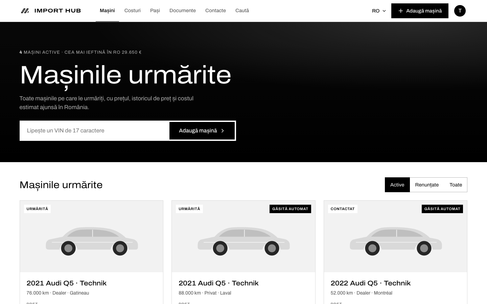

# Import Hub

A family website for importing used cars from Québec to Romania (Viamar Montreal → Rotterdam, Marlog customs in NL, then RAR in Romania). It tracks candidate cars with price history and landed cost, compares them, walks through the import steps and papers per car, keeps contacts and official links, and searches the Québec listing sites with your filters. Available in Romanian, English and French.

Built with Vue 3, Vite and TypeScript. Data lives in Firebase Firestore behind Google sign-in (family members only). Hosted on GitHub Pages.



## Run it

```bash
npm install
npm run dev:mock     # sample data, no Firebase needed
npm run dev          # real data (needs src/firebase.config.ts)
npm test             # cost formula, VIN decoder, templates
npm run e2e          # browser checks at 390/1440 px, light/dark, RO/EN/FR
```

## Chrome extension (optional)

`extension/` fetches photos from listing links in your own Chrome (VPN included): open a car that has a link and no photos, and they appear in the slideshow. Install: download `import-hub-extension.zip` from the site (shown in an empty slideshow) or use the folder, open `chrome://extensions`, turn on Developer mode, **Load unpacked**. After changing `src/lib/listingReader.ts`, run `npm run build:ext`.

## Connect Firebase (once)

1. Create a project at console.firebase.google.com, add a **Web app**, and copy its config into `src/firebase.config.ts` (or into an Actions variable `VITE_FIREBASE_CONFIG` as JSON).
2. **Authentication** → enable the **Google** provider, and add `<user>.github.io` under *Authorized domains*.
3. **Firestore** → create the database, then paste `firestore.rules` into *Rules* and publish.
4. Open the site, sign in, press **Copy code** on the "no access" banner, and create a document `members/<that code>` in Firestore. Repeat for each family member.

## Deploy

Every push to `main` builds and deploys through `.github/workflows/deploy.yml`. In the repo's *Settings → Pages*, set **Source** to **GitHub Actions** (Pages on a private repo needs a paid GitHub plan).

## Layout

- `src/`: the app (views, components, data layer, i18n, cost and VIN logic).
- `tests/unit/`, `tests/e2e/`: checks from `CLAUDE.md` §7.
- `CLAUDE.md`: build rules, data model, formula, VIN decoder, auto-search task spec. `PROJECT_BRIEF.md`: domain knowledge.

## Third-party

- Interface icons: [Audi Icons](https://github.com/oneaudi/audi-icon) (`@audi/audi-icon`), Apache-2.0. Licence text in `public/LICENSE-audi-icon.txt`. No trademark rights are granted; the site uses no Audi logo or font.
- Font: Archivo (Google Fonts, SIL Open Font License).
